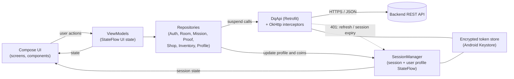

# Daily Quest - Android Client


## 1. Project Overview

Daily Quest is a gamified Android service for building daily habits with friends. Users create or join rooms, complete everyday missions, prove them with photos or videos, and earn coins when their proofs are approved. Coins can be spent in a shop on items for a character and a personal space.

This repository contains the Android client. It communicates with the Daily Quest REST backend (see [Related Repository](#12-related-repository)).

## 2. Key Features

The following features are implemented and connected to the real backend API.

**Accounts and security**
- Email sign-up and login
- Google login (Credential Manager) and Kakao login
- JWT authentication with automatic access-token refresh
- Tokens stored encrypted with an Android Keystore key

**Rooms**
- Public and private room creation, public room search, and joining by invite code
- Room membership and owner-only management (permissions enforced by the server)

**Missions and proofs**
- Daily (app-generated) missions and member-assigned missions
- Photo and video proof submission with upload
- Approval, rejection and resubmission of proofs by room members
- Automatic approval for single-member rooms (applied by the server)
- In-app video playback with thumbnails (Media3 ExoPlayer)
- Mission list filtered by status, with Korean status labels

**Economy**
- Coin rewards for approved missions and streak tracking
- Shop with category filters, item details and purchases
- User inventory
- Coin transaction history
- A single session-backed coin balance shown on the Home, Mission, Shop and My pages

**Profile and account management**
- Profile page with streak and mission statistics
- Nickname editing
- Password change (menu hidden for social-only accounts, based on the server `hasPassword` flag)
- Account withdrawal with confirmation safeguards (password omitted for social-only accounts)

## 3. Screenshots

Screenshots will be added here.

<!--
Add images under docs/screenshots/ and reference them, for example:

-->

| Home | Missions | Proof | Shop | My Page |
|------|----------|-------|------|---------|
| _TBD_ | _TBD_ | _TBD_ | _TBD_ | _TBD_ |

## 4. Tech Stack

| Area | Technology | Version |
|------|------------|---------|
| Language | Kotlin | 2.2.10 |
| Build | Android Gradle Plugin / Gradle | 9.3.3 / 9.5.0 |
| UI | Jetpack Compose (BOM), Material 3 | 2026.02.01 |
| Navigation | Navigation Compose | 2.10.2 |
| Lifecycle | Lifecycle ViewModel / Runtime Compose | 2.10.0 |
| Networking | Retrofit, OkHttp | 3.0.0, 4.12.0 |
| Serialization | Kotlin Serialization (JSON) | 1.9.0 |
| Concurrency | Kotlin Coroutines, StateFlow | 1.10.2 |
| Secure storage | Android Keystore (AES-256/GCM) | platform |
| Media | Media3 ExoPlayer and UI | 1.4.1 |
| Social login | AndroidX Credentials + Google ID, Kakao SDK (`v2-user`) | 1.6.0, 1.1.1, 2.26.0 |
| Unit tests | JUnit 4, kotlinx-coroutines-test, MockWebServer | 4.13.2, 1.10.2, 4.12.0 |
| UI tests | Compose UI Testing, AndroidX Test (JUnit ext, Espresso) | BOM, 1.3.0, 3.7.0 |

**Android requirements:** `minSdk 24`, `targetSdk 37`, `compileSdk 37`, Java 11 source/target compatibility.

## 5. Architecture

The app follows MVVM with a Repository layer and manual dependency injection. `AppContainer` creates the API client, `SessionManager` and repositories, and ViewModels obtain them through `ViewModelProvider.Factory` classes. `SessionManager` holds the authenticated user and coin balance as a `StateFlow` that screens observe, so the balance is shared across screens.



- **UI:** Compose screens under `ui/` and navigation in `navigation/`.
- **ViewModels:** hold screen state as `StateFlow` and guard against duplicate submissions.
- **Repositories:** wrap API calls with `apiCall` and return `ApiResult`, mapping server errors to Korean user-facing messages.
- **Authentication:** an OkHttp interceptor adds the bearer token, an authenticator refreshes it, and a session guard ends the session on unrecoverable 401 responses.

Some screens (avatar customization, room decoration, story) are still sample-data UI and are not connected to the backend; see [Development Status](#10-development-status).

## 6. Project Structure

```
frontend-dq
├── app/src
│   ├── main/java/com/dailyquest/app
│   │   ├── MainActivity.kt, DQApplication.kt
│   │   ├── navigation/            # Routes, NavGraph
│   │   ├── data
│   │   │   ├── remote/            # DqApi, NetworkModule, ApiConfig, ApiError, dto/
│   │   │   ├── auth/              # AppContainer, SessionManager, AuthRepository,
│   │   │   │                      # token store (Keystore), interceptors, social/ (Google, Kakao)
│   │   │   ├── room/              # RoomRepository, validation, error messages
│   │   │   ├── mission/           # MissionRepository and models
│   │   │   ├── proof/             # ProofRepository, UploadRepository, ProofSync
│   │   │   ├── shop/              # ShopRepository, InventoryRepository
│   │   │   ├── profile/           # ProfileRepository, validation, error messages
│   │   │   └── customization/     # Sample-data store for avatar/decoration UI
│   │   └── ui
│   │       ├── auth/, room/, mission/, proof/, shop/, profile/   # ViewModels (and proof screens)
│   │       ├── screens/           # Compose screens
│   │       ├── components/        # Shared Compose components (including the coin pill)
│   │       └── theme/
│   ├── test/                      # JVM unit tests
│   └── androidTest/               # Compose UI / instrumented tests (fake API)
├── docs/social-login-setup.md     # Google/Kakao local setup notes
├── gradle/libs.versions.toml      # Version catalog
└── build.gradle.kts, settings.gradle.kts
```

## 7. Getting Started

### Prerequisites
- Recent Android Studio with an Android SDK that supports API 37
- JDK 11 or newer (the JDK bundled with Android Studio works)
- An emulator or a physical Android device running Android 7.0 (API 24) or higher

### Clone and open
```bash
git clone https://github.com/DQ-Daily-Quest/frontend-dq.git
cd frontend-dq
```
Open the folder in Android Studio and let Gradle sync.

### Local configuration
Email login works without any extra configuration. Social login keys are injected at build time from `local.properties` (not committed) or environment variables. Without them the build still succeeds and the social buttons report that the build is not configured.

```properties
# local.properties (never commit this file)
dq.googleServerClientId=<your-google-web-oauth-client-id>
dq.kakaoNativeAppKey=<your-kakao-native-app-key>
```

Environment variable alternatives: `DQ_GOOGLE_SERVER_CLIENT_ID`, `DQ_KAKAO_NATIVE_APP_KEY`. Values are provided by the backend team. Rebuild after changing them. The server base URL is defined in `ApiConfig.kt`.

For Google and Kakao, your debug signing key must also be registered with the respective console. See [docs/social-login-setup.md](docs/social-login-setup.md) (written in Korean) for details and emulator troubleshooting.

### Build and run
```bash
./gradlew assembleDebug      # build the debug APK
./gradlew installDebug       # install on a connected device or emulator
```
Or select a device in Android Studio and press Run. A device with Google Play services is needed for Google login.

### Run tests
See [Testing](#9-testing).

## 8. API Integration

- **REST client:** `DqApi` is a Retrofit interface using Kotlin Serialization; `NetworkModule` configures OkHttp (timeouts, interceptors); no HTTP body logging is used, and debug error details mask sensitive values.
- **JWT refresh:** requests carry a bearer access token. On `401 TOKEN_EXPIRED`, an OkHttp `Authenticator` refreshes the tokens once (serialized across concurrent requests) and retries the original request. If the refresh token is rejected, the session ends and the user returns to the login screen.
- **Duplicate-request protection:** state-changing requests such as purchases, proof submission, nickname/password changes and withdrawal use the `X-DQ-No-Retry` header, which disables OkHttp's automatic connection retry for that call. ViewModels also block repeated taps while a request is in flight.
- **Lost responses:** when the outcome of a state-changing request is unknown, the app re-queries server state (for example inventory and balance after a purchase) instead of retrying blindly. If a withdrawal result cannot be confirmed, the app reports it as unconfirmed rather than successful.
- **Error handling:** server error codes are parsed into `ApiException` and mapped to Korean messages per feature.

## 9. Testing

Latest recorded results:

- 327 unit tests passed
- 72 instrumented tests passed, run before the final account-withdrawal safety fix
- Debug build successful

The full instrumented suite has not been re-run since that final fix. Only the unit tests were re-run afterwards.

```bash
# Unit tests
./gradlew testDebugUnitTest

# Build the instrumented test APK
./gradlew assembleDebugAndroidTest

# Instrumented tests (requires a running emulator or device)
./gradlew connectedDebugAndroidTest

# A single instrumented test class
./gradlew connectedDebugAndroidTest -Pandroid.testInstrumentationRunnerArguments.class=com.dailyquest.app.ProfileFlowTest
```

Unit tests use JUnit, coroutine test utilities and MockWebServer. Instrumented tests use Compose UI testing with a fake API, so they do not send state-changing requests to a real server.

## 10. Development Status

**Completed**
- Authentication (email, Google, Kakao, JWT refresh)
- Room management
- Mission management
- Proof submission and approval
- Coin rewards
- Shop and inventory
- Profile and account management

**In progress / planned**
- 3D avatar integration (modeling and app integration are handled by a separate team member)
- Room decoration and furniture placement
- Stories and feeds
- Rankings
- Notifications and FCM
- Password recovery
- Final integration and physical device testing

## 11. Team

**Team JJJ (Triple J)**

Individual member roles are not listed yet. See the [contributors page](https://github.com/DQ-Daily-Quest/frontend-dq/graphs/contributors) for commit authors.

## 12. Related Repository

- Frontend: https://github.com/DQ-Daily-Quest/frontend-dq
- Backend: https://github.com/DQ-Daily-Quest/backend-dq
